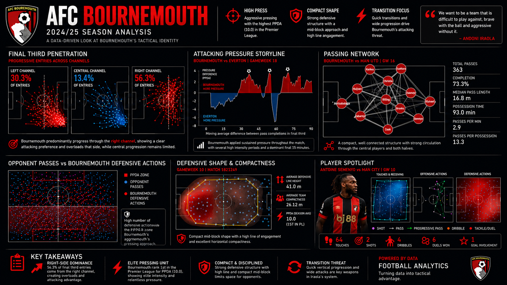
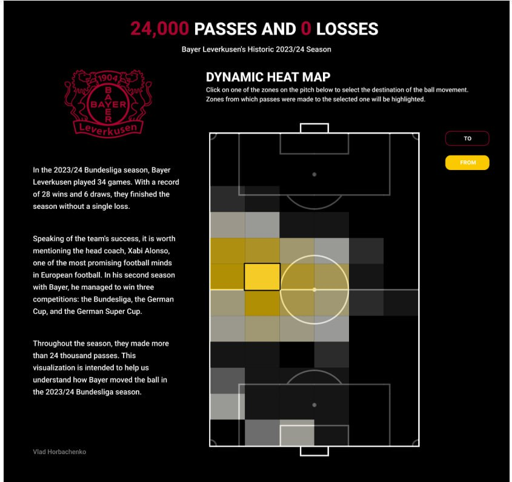

::: {align="center"}
```{=html}
<!-- HERO / BANNER -->
```
``{=html}

`<a href="https://linkedin.com/in/amrrabie445">`{=html}``{=html}`</a>`{=html}
`<a href="mailto:YOUR_EMAIL@example.com">`{=html}``{=html}`</a>`{=html}
`<a href="https://github.com/YOUR_GITHUB_USERNAME">`{=html}``{=html}`</a>`{=html}

*I turn complex data into clear insights, practical decisions, and
compelling stories.*
:::About
I'm a Computer Science graduate and Junior Data Analyst with a strong
interest in business intelligence, data storytelling, and football
analytics.

My work combines analytical thinking with hands-on tools to clean,
explore, visualize, and communicate data. I have completed Data Analysis
training at the National Telecommunication Institute (NTI), undertaken a
two-month remote internship at Brainwave Matrix, and built academic and
personal projects using real-world datasets.
::: {align="center"}
  -----------------------------------------------------------------------
    DATA ANALYSIS       BUSINESS          FOOTBALL          LEARNING
                      INTELLIGENCE        ANALYTICS     
  ----------------- ----------------- ----------------- -----------------
    Python & SQL    Excel & Power BI   Match & player   Always improving
                                          analysis      

  -----------------------------------------------------------------------
:::What I do
<table>
<tr>
<td width="50%" valign="top">
Data analysis
- Data cleaning and preparation
- Exploratory data analysis
- SQL querying and data extraction
- KPI analysis and reporting
- Finding trends and actionable insights
</td>
<td width="50%" valign="top">
Dashboards & BI
- Power BI dashboard development
- Data modeling and DAX
- Excel analysis and reporting
- Interactive data visualization
- Communicating results clearly
</td>
</tr>
<tr>
<td width="50%" valign="top">
Football analytics
- Team and player performance
- Expected goals (xG) analysis
- Pressing and PPDA
- Passing networks and patterns
- Tactical and match analysis
</td>
<td width="50%" valign="top">
Tools & workflow
- Python, Pandas, NumPy
- SQL
- Microsoft Excel
- Power BI and Power Query
- Matplotlib and mplsoccer
</td>
</tr>
</table>
Selected projects
An overview of my analytics work. Replace each image path and project
URL with the real files and repositories.
<table>
<tr>
<td width="50%" valign="top">
<a href="YOUR_BOURNEMOUTH_REPO_LINK">{=html}
{=html}
</a>{=html}
01 --- AFC Bournemouth | Premier League 2024/25
A tactical and performance analysis of Bournemouth, exploring the team's
playing style through event data and visualizations.

Focus - xG and attacking output - PPDA and pressing behavior -
Defensive height and structure - Passing networks and final-third
entries

Stack: Python · Pandas · StatsBomb data · Matplotlib · mplsoccer

Explore project →
</td>
<td width="50%" valign="top">
<a href="YOUR_LEVERKUSEN_REPO_LINK">{=html}
{=html}
</a>{=html}
02 --- Bayer Leverkusen | Invincible Season
An analysis of Bayer Leverkusen's unbeaten 2023/24 Bundesliga campaign,
combining team metrics and player-level performance.

Focus - xG and xGA - Possession and pressing - Attacking and
defensive performance - Player comparisons and passing networks

Stack: Python · Pandas · Power BI · StatsBomb data

Explore project →
</td>
</tr>
<tr>
<td width="50%" valign="top">
<a href="YOUR_SPOTIFY_REPO_LINK">{=html}
{=html}
</a>{=html}
03 --- Spotify 2023 | Power BI Dashboard
An interactive dashboard exploring music streaming performance, artists,
tracks, and audio features.

Focus - Most-streamed artists and tracks - Streaming distribution -
Track and artist comparisons - Audio feature analysis

Stack: Power BI · DAX · Power Query

Explore project →
</td>
<td width="50%" valign="top">
<a href="YOUR_SALES_REPO_LINK">{=html}
{=html}
</a>{=html}
04 --- Sales & Business Intelligence
A collection of business intelligence dashboard work focused on turning
operational data into useful performance indicators.

Focus - Sales and product performance - KPI monitoring - Trends and
comparisons - Dashboard design and reporting

Stack: Power BI · Excel · DAX

Explore project →
</td>
</tr>
</table>
Project images: Add your dashboard screenshots to an assets
folder in this repository using the filenames shown above. If you do
not have a screenshot for a project yet, replace the image with one
you do have or remove that image element.

My approach
::: {align="center"}
  -----------------------------------------------------------------------
   01 · Understand    02 · Prepare      03 · Analyze    04 · Communicate
  ----------------- ----------------- ----------------- -----------------
     Define the         Clean and     Explore patterns    Present clear
      question        validate data       and KPIs          findings

  -----------------------------------------------------------------------
:::I aim to make every analysis understandable and useful: start with the
question, check data quality, choose the right methods, and communicate
the findings with clear visuals and context.
Tools I use
::: {align="center"}
``{=html}

`<br/>`{=html}

``{=html}
``{=html}
``{=html}
``{=html}
``{=html}
``{=html}
:::Education & experience
  Education                       BSc in Computer Science

  Professional training           Data Analysis --- National
Telecommunication Institute (NTI)

  Internship                      Remote internship --- Brainwave
Matrix (2 months)

  Additional learning             Machine Learning Specialization ---
DeepLearning.AI; Supervised Machine
Learning --- Stanford / Coursera
GitHub activity
::: {align="center"}
``{=html}
``{=html}
:::Let's connect
I'm interested in opportunities as a Junior Data Analyst, Data Analyst,
or Football Data Analyst, and in collaborating on projects involving
analytics, dashboards, and performance insights.
::: {align="center"}
`<a href="https://linkedin.com/in/amrrabie445">`{=html}``{=html}`</a>`{=html}
`<a href="mailto:YOUR_EMAIL@example.com">`{=html}``{=html}`</a>`{=html}

`<br/>`{=html}`<br/>`{=html}

*Thanks for visiting --- feel free to explore my projects.*

``{=html}
:::
